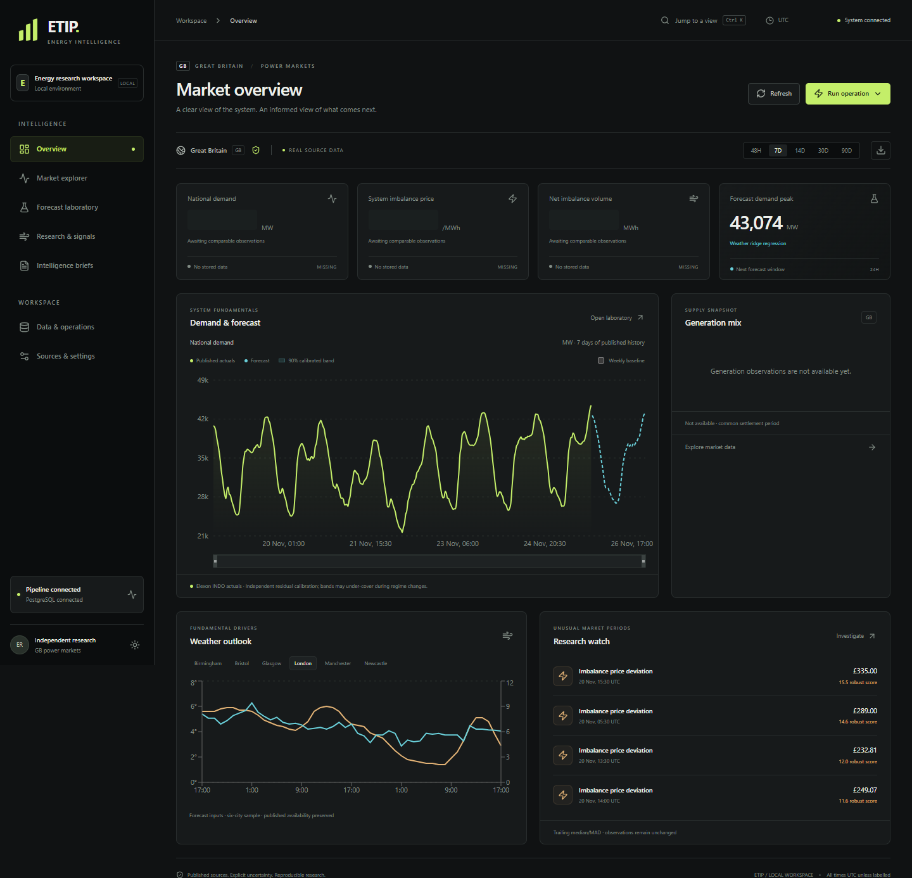

# ETIP · Energy Trading Intelligence Platform

A working local application for Great Britain electricity research: real public data, a PostgreSQL warehouse, automatically refreshed fundamentals, evaluated demand forecasts, interactive research, and evidence-led reports.

**Current scope:** GB national/transmission demand, generation by fuel type, settlement imbalance prices and volumes, and six-city weather forecasts. The application does not execute trades. NESO and ENTSO-E are documented expansion sources, not connected feeds. No observations or missing values are replaced by synthetic data.



More screenshots: [forecast laboratory](docs/screenshots/forecast-laboratory.png) · [mobile workspace](docs/screenshots/mobile.png).

## Run locally

Requirements: Node.js 22+ and Python 3.12+. Docker, Redis, Celery, TimescaleDB, cloud accounts and system-wide PostgreSQL are not required. The project can launch a persistent native PostgreSQL cluster bound to `127.0.0.1:5433`.

```powershell
npm ci
npm run setup
npm start
```

Open **http://127.0.0.1:3000**. API documentation is at **http://127.0.0.1:8000/docs**.

On first startup the worker queues a 120-day real-data backfill. It then archives historical weather forecasts, evaluates models and writes an evidence brief. These operations take several minutes and their progress is visible under **Data & operations**. Provider failures stay visible and can be retried. Nothing is served as populated data before it actually arrives.

Stop with Ctrl+C in the startup terminal or `npm stop` from a second terminal. Services shut down and stored data remains on disk. Keep the PC awake and connected for scheduled updates. After downtime the worker catches up recent missing periods; interrupted jobs remain inspectable and can be requeued.

If Python is not on PATH, set `ETIP_PYTHON` to its executable before `npm run setup`. This workstation's environment was created using the bundled Python runtime. A fresh workstation needs its own Python installation.

## What you can use

| View | Working functionality |
|---|---|
| Overview | Current published KPIs, demand and forecast curves, generation snapshot, weather outlook and anomaly watch |
| Market explorer | Range controls, national/transmission demand separation, imbalance prices/volumes, chart brush/zoom, source ledger and CSV export |
| Forecast laboratory | Direct 24h predictions, calibrated bands, historical test curves, baseline/model comparison, experiment history and limitations |
| Research & signals | Exact-timestamp demand/price scatter, Pearson correlation, weekday/hour heatmap and trailing median/MAD anomaly investigation |
| Intelligence briefs | Deterministic verified reports; optional LLM synthesis with evidence references, numeric-claim checks and execution trace |
| Data & operations | Durable jobs, retries, source events, coverage, revisions, freshness, and the engineering problem/fix register |
| Sources & settings | Provider documentation, source scope, credential availability and persisted automation settings |

Keyboard shortcut: **Ctrl+K** opens workspace navigation. The interface includes light/dark themes and a responsive mobile navigation drawer.

## Where the data comes from

| Provider | Connected use | Access and caveats |
|---|---|---|
| [Elexon Insights](https://developer.data.elexon.co.uk/) | INDO national demand, ITSDO transmission demand, actual generation by type, system sell price and net imbalance volume | Public API, no key. These are published system fundamentals and imbalance settlement prices; they are not executable exchange quotes. Each endpoint has its own date parameter contract. |
| [Open-Meteo](https://open-meteo.com/en/docs) | Operational forecasts for London, Birmingham, Manchester, Glasgow, Bristol and Newcastle | Noncommercial free API within provider limits. Six-city sampling is not a national spatial average. [Commercial access](https://open-meteo.com/en/pricing) requires the appropriate subscription. |
| [Open-Meteo Single Runs](https://open-meteo.com/en/docs/single-runs-api) | Archived ECMWF forecast runs for weather feature evaluation | Initialization is not availability. Historical runs use an explicitly recorded initialization + 8h availability assumption; live responses use actual retrieval time. |

Contains BMRS data © Elexon Limited, copyright and database right. Weather data is supplied by Open-Meteo and underlying model providers under CC BY 4.0. Preserve source attribution and review provider terms before commercial redistribution.

## Persistence and operation

- PostgreSQL tables retain observations and revisions, publication/retrieval timestamps, weather forecast vintages, jobs, source events, model cards, forecast curves and reports.
- `data/raw/` retains immutable provider JSON and request/checksum metadata.
- `data/models/` retains trained estimators, exact training samples and forecast feature snapshots.
- `data/backups/` retains database backups. When native `pg_dump` is unavailable, a repeatable-read logical ZIP includes all database tables, raw archives and model files. ZIP integrity is checked after creation.
- `data/local-secrets.json` holds generated local database/session credentials and is excluded from backups and version control. Existing root `.env` is preserved; only optional LLM credentials are reused from it.
- A single PostgreSQL-locked worker runs persisted jobs. Default source refresh is every 30 minutes, model evaluation every six hours, reports every twelve hours, and backups daily while automation is enabled.

Optional overrides belong in `.env.local`; see [.env.local.example](.env.local.example). To use an existing PostgreSQL server set `ETIP_DATABASE_URL`. Restart services after changing backend configuration. Rebuild the frontend after changing `ETIP_API_ORIGIN`, because rewrites are captured in the build. Credentials never go into frontend bundles.

## Data science protocol

The target is **GB Initial National Demand Outturn, in MW**, with 48 half-hourly predictions. Candidate models include a same-period-last-week baseline, standardized Ridge regression, and histogram gradient boosting. The same Ridge/boosting models with weather features are included only when archived forecast coverage is complete.

1. Build lag/calendar features from values published by each forecast origin. Never interpolate gaps or substitute future observations. Calendar features use Europe/London; storage and forecast windows use UTC.
2. Fit estimators and scalers before each evaluation origin. Keep an independent trailing seven-day residual calibration window.
3. Select the champion by RMSE on an earlier seven-day validation period.
4. Freeze that model-family choice, then evaluate seven subsequent daily origins. Expanding training may use earlier test observations once they have been published; this is prequential walk-forward evaluation.
5. Report RMSE, MAE, WAPE, bias, interval coverage and sample sizes. WAPE is undefined when the absolute actual sum is zero. Calibration is empirical; distribution shifts and serial dependence can invalidate nominal coverage.
6. Record input fingerprints, sample/feature snapshots, versions, seed, feature set, splits, scores and limitations per run. Score stored operational predictions when actuals become available.

Historical features use the provider's available publication timestamps. Complete historical revision vintages cannot be reconstructed if a provider only returns its latest revision. Strict **as-recorded** replay is possible only for locally collected vintages; this limitation is stated in model cards.

Measured results from the verified build are recorded in [docs/EVALUATION_RESULTS.json](docs/EVALUATION_RESULTS.json). They are one observed evaluation window, not a promise of future performance or trading profitability.

## Verification

With the local database running:

```powershell
npm run check
npm run test:browser
```

The check command runs Ruff, formatting checks, unit tests, isolated PostgreSQL integration tests, TypeScript, ESLint and a production frontend build. Browser tests use installed Chrome on this Windows workstation; on other systems install Playwright Chromium with `npx playwright install chromium` or set `ETIP_BROWSER`.

Integration tests create and drop a randomly named `etip_test_*` database. They never clear the application database. Unit-test fixtures may use deterministic invented values to test edge cases; application observations always come from providers.

## Problems, fixes and current boundaries

- [Engineering register](docs/ENGINEERING_LOG.json): structured issue, fix, verification and status records, also visible in the UI.
- [Build journal](docs/BUILD_JOURNAL.md): implementation history and decisions.
- [Runbook](docs/RUNBOOK.md): operation, backup/restore and recovery.
- [Architecture](architecture.md): current components and contracts.
- [Research protocol](docs/RESEARCH_PROTOCOL.md): validation details and interpretation.

This is a curated source release. Local data, credentials, build output and preserved legacy material are excluded; the original local repository metadata remains untouched.

The active application is local and single-user. It has no live gas/carbon feed, order book, exchange execution, cloud hosting, or independently verified historical weather publication times. LLM synthesis requires a valid provider key; deterministic reports work without one. These boundaries are explicit throughout the product.
