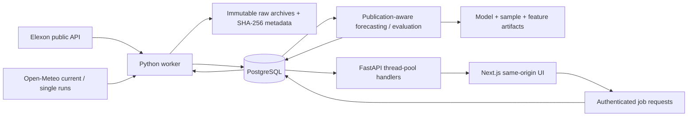

# Current architecture — ETIP local application

## Runtime

`npm start` launches a persistent native PostgreSQL cluster (or uses `ETIP_DATABASE_URL`), initializes schema version 1, then starts the FastAPI service, one durable Python worker and the Next.js frontend. Everything binds to loopback. PostgreSQL uses SCRAM authentication and generated credentials; browser write operations require a local session token plus an allowed Origin. Trusted Host checks constrain browser-facing hostnames.

## Code ownership

| Module | Responsibility |
|---|---|
| `backend/app/config.py` | Absolute configuration roots, generated local credentials, optional LLM access |
| `db.py` | Typed ORM tables, transactions and serialized schema initialization |
| `repository.py` | Latest-vintage and as-of queries with explicit availability bases |
| `collectors.py` | Provider contracts, retries, immutable archives, validation and conflict-safe persistence |
| `forecasting.py` | Direct horizon features, chronological selection, walk-forward testing, residual calibration and model artifacts |
| `reports.py` | Evidence collection, availability gate, synthesis and grounding checks |
| `jobs.py` / `worker.py` | Database queue, deduplication locks, claiming, heartbeat, recovery and scheduling |
| `operations.py` | Quality summaries, descriptive research, anomaly statistics, backup and empty-database restore |
| `main.py` / `server.py` | API contracts, local write protection and supervised shutdown |
| `frontend/src/components` | Responsive workspace, charts and research/operations views |
| `scripts/` | Setup, native database lifecycle, service supervisor, checks and research export |

## Data model

- `observations`: metric, market, settlement time, value/unit, provider publication time, first local retrieval time, archive reference and availability basis. A hash includes source/metric/time/value/publication identity. Silent corrections create distinct vintages; identical responses do not create repeated observations.
- `weather_vintages`: location, run time, available time, valid time, temperature, wind speed, radiation, availability basis and source archive. Current forecast composites use retrieval time; historical single runs use the documented assumed delay.
- `jobs`: durable parameters, status, heartbeat, progress, result and timestamps. Per-kind advisory locks serialize deduplication. Claiming uses `FOR UPDATE SKIP LOCKED`.
- `pipeline_events`: per-source request outcome, accepted/rejected counts and raw archive path.
- `model_runs` / `forecast_points`: frozen model cards, test/selection metrics, artifacts, forecasts, bounds, baseline and eventual actuals.
- `reports`: evidence facts, warnings, synthesis engine, validated paragraphs and workflow trace.
- `app_settings` / `worker_state`: persisted automation configuration and liveness.

Schema v1 is created under a transaction-scoped PostgreSQL advisory lock. Future column/table changes require explicit versioned migrations; `create_all` is not a substitute for upgrading an existing schema.

## Time and meaning

All timestamps are timezone-aware UTC in storage. GB settlement-date request windows are derived from Europe/London midnight boundaries, so daylight-saving days retain their true duration. Inputs are rejected rather than silently rounded. National and transmission demand remain separate. Imbalance settlement prices are never labelled day-ahead or executable exchange prices.

Latest views select one vintage per metric/settlement time. `as_of` filters provider publication; `recorded_as_of=true` additionally filters local retrieval. The distinction prevents downloaded historical data from being presented as locally known before collection.

## Failure and restart behavior

Provider timeouts/rate limits have bounded retry. Request failures become source events and partial/failed jobs, not fabricated values. Duplicate imports are safe. Worker leases are refreshed independently during longer jobs. A worker advisory lock prevents duplicate schedulers. On restart, unfinished jobs are marked interrupted and preserved for inspection/retry.

The Node supervisor uses per-run shutdown markers for cooperative Python shutdown and `pg_ctl` for orderly database stop. Native process completion waits on `exit`, avoiding inherited-pipe hangs on Windows. A final process-tree termination is a bounded fallback; it applies only to children of the current supervisor.

## Deliberate limits

Local single-user operation, provider publication cadence, finite historical revision availability, assumed archived-weather availability, six-city weather sampling, short historical evaluation windows, and optional external LLM access are explicit constraints. There is no automated trade execution. Broader market adapters and cloud deployment can be added behind the current provider/repository contracts.
